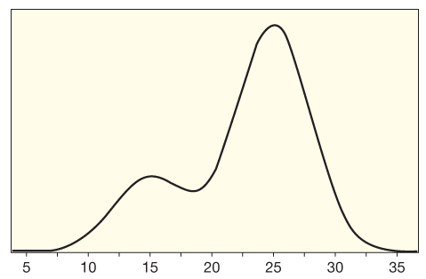

$\\$


The purpose of this homework is to practice exploring normal distributions, and
to run parametric hypothesis tests and create parametric confidence intervals
for proportions. Please submit a compiled pdf with your answers to the exercises
to Gradescope *by 11pm on Sunday November 15th*.

Functions you might find useful are `rnorm()`, `plot_norm()`, `pnorm()`, and
`cnorm()`, along with the list of functions found on Canvas. For full credit on
problems involving R, be sure to label all your figures and to "show your work"
by making sure all values that are answers to questions are printed/visible in
your Quarto pdf document. When you add a line to a plot with `abline()`, put the
`abline()` code in the same code chunk as the code that creates the plot;
otherwise, the line will not appear in your rendered pdf.

As always, if you need help with any of the homework assignments, please attend
the TA office hours which are listed on Canvas and/or ask questions on Ed
Discussion forum. Also, if you have completed the homework, please help others
out by answering questions on Ed Discussion. Finally, reviewing the class
slides and videos will be helpful if you run into difficulties, and attending
the Practice Sessions will be very useful to solidify your knowledge.

Note: The "seed" to generate random numbers is set at the top of this Quarto
document. This will allow you to get the same answers every time you render the
document, and thus to answer questions that involve randomness in a consistent
way (i.e., you can read out results generated by random functions from the
rendered pdf and then comment on these results). In order to make it easier to
grade the homework, please do not change this seed, and do **not** call the
set.seed function anywhere else in the Quarto document. Also, to obtain
consistent values that you write in the answer sections (where applicable),
please render your file to a pdf first, and then write in the numbers from the
rendered pdf into the answer sections. If you run code chunks one at a time in
RStudio, the random numbers you see can differ from those in the rendered pdf,
so always report the numbers from the rendered pdf.


<!-- This R chunk sets some parameters that will be used in the rest of the document. 
Please ignore it and do not modify it. -->

```{r message=FALSE, warning=FALSE, tidy=TRUE, echo=FALSE}
    
library(SDS1000)
library(knitr)

options(scipen=999)

set.seed(100)


```


$\\$


## Part 1: Exploring normal distributions


In the first set of exercises you will explore normal distributions using R. I
encourage you to review the examples in the Lock5 textbook for additional
practice.

For all exercises, please write your answers in the answer section. For the
questions that involve calculations, please use the R chunks (that are above the
answer sections) to do your calculations and "show your work" by printing the
relevant results.


$\\$


**Exercise 1.1 (4 points)**: Figure 1 below shows a plot of a density curve.
From looking at this density curve, what is the probability of getting a
random number X that is greater than 30; i.e., what do you think the value of
P(X > 30) is?



Please select from the following choices by pasting your choice into the answer
section below.

a. 0.04

b. 0.27

c. 0.50

d. 0.73

e. 0.95


**Answer:**


$\\$


**Exercise 1.2 (9 points)**: Please use the `pnorm()` function to  find the 
areas on the standard normal density curve N(0, 1) listed below. Write your
answers in the answer section below, and use the R chunk below to calculate
these values. As always, be sure to show your work by printing out the results 
in the R chunk.

a. The area below z = 0.8

b. The area above z = -1.5

c. The area between z = -1.75 and z = 0.5


Note:

1. You can check your answers using the apps at: 
(<https://emeyers.github.io/SDS1000/apps/normal_area/>) and
(<https://emeyers.github.io/SDS1000/apps/normal_range/>)

2. You can also use the `mosaic::xpnorm()` function to visualize your results. 
The `mosaic::xpnorm()` function works the same way as the `pnorm()` function but
it will also display a visualization of the distribution which is useful to
confirm that you have the correct result.


```{r q1_2, message=FALSE, warning=FALSE, tidy=TRUE, fig.width=3, fig.height=2}


# a. The area below z = 0.8


# b. The area above z = -1.5


# c. The area between z = -1.75 and z = 0.5


```


**Answers:**

a. 


b. 


c. 


$\\$


 
**Exercise 1.3 (10 points)**:  A Statistics professor designed an online exam so 
that the grades would be roughly normally distributed with mean $\mu$ = 75 and
standard deviation $\sigma$ = 10. Unfortunately, the Canvas website that the
students were taking the exam on crashed with ten minutes to go in the exam
which made it difficult for some students to finish. When the instructor graded
the exams, he found that the grades were roughly normally distributed, but the
mean grade was 62 and the standard deviation was 18. 

To be fair, the professor decides to "curve" the scores to match the desired 
N(75, 10) distribution. To do this, he standardizes the actual scores to
z-scores using the N(62, 18) distribution and then "unstandardizes" those
z-scores to convert to N(75, 10).

Please answer the following questions about this situation in the answer section
below, and "show your work" in the R chunk above the answer section.

a. What is the new grade assigned for a student whose original score
was 47? 

b. How about a student who originally scores a 90? 


Hint: use the R chunk below to convert the two original scores to z-scores and
then convert them back to the new scores from the N(75, 10) distribution.


```{r q1_3, message=FALSE, warning=FALSE, tidy=TRUE}

# a. 


# b. 


```


**Answers:**

a. 


b. 


$\\$ 
 


 
**Exercise 1.4 (9 points)**: Find the p-value based on the standard normal 
distribution for each of the following standardized test statistics. By an
upper-tailed test, we mean a test where the alternative hypothesis is framed as
$H_A: \text{parameter} > x$, by a lower-tailed test, we mean a test where it is
framed as $H_A: \text{parameter} < x$, and by a two-tailed test, we mean a test
where it is framed as $H_A: \text{parameter} \ne x$.
Please show the code you used to get your answers below, or explain how you got
your answers.


a. z = 0.84 for an upper tail test for a difference in two proportions.

b. z = -2.38 for a lower tail test for a difference in two means.

c. z = 2.225 for a two-tailed test for a single proportion. 


```{r message=FALSE, warning=FALSE, tidy=TRUE}

# a. 


# b.


# c.


```


**Answers:**


a. 


b. 


c. 


$\\$  
 


## Part 2: Parametric confidence intervals for proportions


In the next set of exercises you will practice computing confidence intervals
for a single proportion using parametric methods based on the normal
distribution. I encourage you to review the examples in the Lock5 textbook for
more practice. Also, for all your answers, be sure to "show your work" by
printing the output of your calculations in the R chunks.
 
 
 
 
 $\\$
 
 
 
 
 
**Exercise 2.1 (10 points)**: A study published in 2010 found that, of the 1771
participants aged 12 to 19 in the 2005-2006 National Health and Nutrition
Examination Survey, 19.5% had some hearing loss (defined as loss of 15 decibels
in at least one ear). This was a dramatic increase from about 15 years earlier.
The sample size is large enough to use
the normal distribution, and a bootstrap distribution shows that the standard
error for the proportion is SE = 0.009. Find and interpret a 90% confidence
interval for the proportion of teenagers with some hearing loss. Use the code
chunk below to show your work.


```{r q2_1, message=FALSE, warning=FALSE, tidy=TRUE}


```


**Answer:**


$\\$


**Exercise 2.2 (10 points)**: Suppose we have a population proportion $\pi$ = 0.27. 
Let's create the sampling distribution for n = 50 observations of a categorical 
variable by doing the following:

a. First, find the mean and the standard error of the sampling distribution of
proportions using the formulas we discussed in class. Use the R chunk below to
create objects that have these values and print out these values to "show your work".

b. Second, plot the sampling distribution using the `plot_norm()` function. In
the answer section, report whether the sample size is large enough for this
normal density function to be valid to use as the sampling distribution and
explain why.


```{r message=FALSE, warning=FALSE}

# a. report/calculate the mean and SE of the sampling distribution


    
    
# b. plot the density curve


# checking that the sample size is large enough to use a normal approximation


    

```


**Answers:**

a. 


b. 


$\\$


**Exercise 2.3 (12 points)**:  In a survey of 1,000 US adults, twenty percent say 
they never exercise. This is the highest level seen in five years. Use the R
chunk below to:

a. Run calculations to check if the sample size is large enough to use a normal
distribution.

b. Report what the margin of error would be if a 99% confidence level was used. 

c. Find a 99% confidence interval for the proportion of US adults who say they
never exercise.

d. Interpret what the 99% confidence interval tells you.


```{r q2_3, message=FALSE, warning=FALSE, tidy=TRUE}


# a. calculate whether using a normal distribution is appropriate here


# b. calculate the margin of error


# c. create the confidence interval 


```


**Answer:**  


a. 


b. 


c. 


d. 


$\\$


## Part 3: Parametric hypothesis tests for proportions


In the last set of exercises you will practice running hypothesis tests for a
single proportion using parametric methods based on the normal distribution.
Also, for all your answers, be sure to "show your work" by printing the output
of your calculations in the R chunks.
 


$\\$

**Home Field Advantage in Baseball** Do home teams have an advantage in Major 
League Baseball (MLB)? Let's run a hypothesis test to see if there is sufficient
evidence to conclude that home teams win more than 50% of the games they play.

To run this hypothesis test, let's use data from the 2014 season as a sample of 
all MLB games. During the 2014 season, there were 2428 Major League Baseball 
games played and the home team won 1288 of those games. 

For this set of exercises, we will use a parametric hypothesis test based on the
normal distribution. Let’s also use our typical significance level of $\alpha$ =
0.05. Please complete the exercises outlined below to go through our 5 steps of
hypothesis testing in order to determine whether there is a home field
advantage.


$\\$


**Exercise 3.1 (8 points)** Step 1: As always, let's start our hypothesis test by 
stating the null and alternative hypotheses in words and symbols. 


**In words**

The null hypothesis: 


The alternative hypothesis: 


**In symbols**


$\\$


**Exercise 3.2 (9 points)** Step 2: Next, please calculate the test statistic of
interest which in this case is a z-statistic that comes from a standard normal
distribution. To calculate this z-statistic, please complete the steps listed
below. Also, please do your calculations in the R chunk below and print out the
results to show your work. Then fill in your written answers in the answer
section.

a. Write down the observed proportion using the appropriate symbol, and the sample
size using the appropriate symbol. Also, save the observed proportion to an
object named `p_hat`. 

b. Calculate the standard error SE one would get *if the null hypothesis was true*. 
To do this, use the (appropriate) formula we discussed in class.

c. Calculate the test statistic (i.e., the z-statistic) based on the observed
proportion and the SE you calculated in step b, and save this to the name
`z_stat`.


```{r 3.2}


```


**Answer:** 

a. 


b. 


c.


$\\$


**Exercise 3.3 (6 points)** Step 3: Now write code to visualize what the null 
distribution looks like using the `plot_norm()` function. Also, add a red line to
your null distribution at the value of the observed z-statistic you calculated
above.

Hint: This is a very common null distribution!


```{r 3.3}


```


$\\$


**Exercise 3.4 (5 points)** Step 4: Now calculate the p-value from our normal
null distribution, and report the p-value in the answer section.


```{r 3.4}


```


**Answer:**


$\\$


**Exercise 3.5 (4 points)** Step 5: Finally, draw a conclusion. Also, interpret 
your decision in the context of the problem; i.e., what does your analyses say
about whether there is a home field advantage?


**Answer:** 


$\\$


**Exercise 3.6 (7 points)** As a last set of exercises, let's compare these
results to results we would get from running a "randomization test" where
we use computer simulations to get a p-value. 

Since we've already stated the null and alternative hypothesis, and calculated
the observed proportion, please proceed to step 3 of hypothesis testing and
calculate the null distribution.

Please create a null distribution of proportions, rather than z-statistics,
(although it is also possible to run a randomization test using z-statistics).
Once you've created the null distribution, please visualize it and plot the
observed proportion as a red line on the plot.


```{r 3.6, message=FALSE, warning=FALSE, tidy=TRUE}

library(SDS1000)


```


$\\$


**Exercise 3.7 (6 points)** Finally, do steps 4 and 5 of hypothesis testing by 
calculating the p-value from the randomization null distribution. Also, write
down what you would conclude based on this p-value and whether your conclusions
differ from those you arrived at running the parametric test (i.e., are they
different from the conclusions you drew in exercise 3.5?)


```{r 3.7}


```


**Answer:** 


$\\$ 
 


## Reflection (3 points)


Please reflect on how the homework went by going to Canvas, going to the Quizzes 
link, and clicking on Reflection on homework 8.


  
